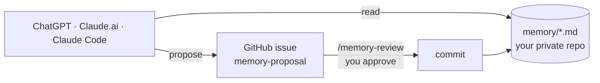

# one-memory

**One professional memory for ChatGPT, Claude.ai and Claude Code.** Plain Markdown in a private GitHub repository that you own. Assistants read it and propose changes. Nothing changes until you approve it.

> **A template, not a service.** You create your own private copy. Nothing is hosted, synced or collected, and your conversations stay where they are: only the facts you approve get stored. The person in `examples/` is fictional.

## Why

Every assistant keeps its own memory. ChatGPT knows about your new project and Claude doesn't; Claude Code knows your conventions and ChatGPT doesn't. You can't easily see what they remember, correct it or take it with you, and they decide on their own what to keep.

## How it works

1. **Read.** Assistants read `memory/core.md`, a short summary, plus topic files when a conversation needs them.
2. **Propose.** When something durable comes up, the assistant opens a GitHub issue labeled `memory-proposal`. If it can't, it gives you the text to paste.
3. **Approve.** You run `/memory-review` in Claude Code and approve, edit or reject each change. It commits and closes the issues. Git history is the audit log.

Every assistant follows [PROTOCOL.md](PROTOCOL.md). It is professional context only: no health, family, finances, contact details, IDs, secrets or confidential employer information.

## Quick start

About 15 minutes. Step-by-step details are in [docs/SETUP.md](docs/SETUP.md).

1. **Use this template → Private.** Don't fork: forks of public repositories are public.
2. **Clone it and run two commands**: one creates the `memory-proposal` label, the other fills in your repository's name.
3. **Connect Claude Code.** It's required because it runs the reviews: [guide](docs/platforms/claude-code.md).
4. **Fill in your memory**, or start empty: [docs/MAKE-IT-YOURS.md](docs/MAKE-IT-YOURS.md).
5. **Connect Claude.ai and/or ChatGPT** (optional): [Claude.ai](docs/platforms/claude-ai.md) · [ChatGPT](docs/platforms/chatgpt.md).
6. **Verify it works**: [docs/VERIFY.md](docs/VERIFY.md).

## What to expect

| | Reads memory | Proposes changes |
|---|---|---|
| Claude Code | `core.md` is imported when a session starts | Opens the issue with `gh` |
| Claude.ai | Through a GitHub connector, when Claude calls it, or from a project snapshot | Opens the issue after you approve, or copy-paste |
| ChatGPT | Through the GitHub app, when ChatGPT calls it (depends on your plan) | Copy-paste; directly only with a connector that can create issues |

Assistants follow instructions; they don't give guarantees. In the chat apps, memory is read only when the assistant decides to call its connector. Check each platform with the [tests](docs/VERIFY.md), and run them again when something changes. _Platform details last checked: November 2026._

## Daily use

- Work as usual. Say "remember this" when something should stick.
- Run `/memory-review` in Claude Code when proposals are waiting.
- Now and then, change `read_check` in `core.md` and ask an assistant "What's my read check?" to confirm it sees the latest version.

## See it in action

[examples/moishe-zuchmir](examples/moishe-zuchmir/README.md) is a complete memory for a fictional engineer, with a [walkthrough](examples/moishe-zuchmir/WALKTHROUGH.md) of one full loop: conversation → proposal → issue → review → commit.

## What's inside

| Path | Purpose |
|---|---|
| [PROTOCOL.md](PROTOCOL.md) | Rules for assistants: reading, proposing, privacy |
| [memory/](memory/core.md) | Your memory: empty templates to start with |
| [.claude/skills/memory-review/](.claude/skills/memory-review/SKILL.md) | The `/memory-review` approval command |
| [.github/ISSUE_TEMPLATE/](.github/ISSUE_TEMPLATE/memory-proposal.yml) | The proposal form |
| [docs/](docs/SETUP.md) | Setup, platform guides, verification |
| [examples/](examples/moishe-zuchmir/README.md) | Fictional demo data |

No code, no server, no tokens, no GitHub Actions.

## Security

Your memory lives in a private repository. Assistants get read access and, at most, the ability to open issues, limited to that one repository. Files change only through a review you approve. The threat model and a least-privilege checklist are in [SECURITY.md](SECURITY.md).

## Contributing and license

See [CONTRIBUTING.md](CONTRIBUTING.md). Released under the [MIT License](LICENSE).
